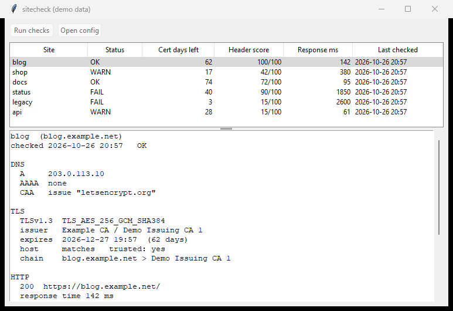

# sitecheck

A small monitor for sites you own. It checks the TLS certificate (expiry, issuer, chain, host name, protocol version), the HTTP status and redirect chain, whether plain http:// redirects to https://, the common security headers (scored out of 100, with a one-line fix for the worst gap), response time, and DNS A/AAAA/CAA. Every run is stored in SQLite, and changes between runs (new certificate, new issuer, status flip, different IPs) go into a change log.

Python 3.12+ and the standard library only. Developed on 3.14, Windows.

## Use

    sitecheck init                 # writes a sample sitecheck.toml
    sitecheck run                  # check every site, store results
    sitecheck run -s blog -v       # one site, full detail
    sitecheck report --html        # sitecheck-report.html from the stored results
    sitecheck log                  # what changed between runs
    sitecheck gui                  # window showing the last stored results

Without installing: `python -m sitecheck run`. `pip install -e .` gives a `sitecheck` command.

The config is TOML, found via `--config`, `$SITECHECK_CONFIG` or `./sitecheck.toml`:

    [settings]
    timeout = 8
    warn_days = 21

    [[site]]
    name = "blog"
    host = "blog.example.org"

`init` writes the full list of per-site options (ports, path, HEAD instead of GET, a private `ca_file`).

`run` exits 0 when everything is fine, 1 when any site has a warning or failure (certificate within `warn_days`, expired, untrusted or wrong-name certificate, HTTP 4xx/5xx, no http->https redirect, slow response, header score under `min_score`), and 2 for config errors. That makes it usable from cron or CI as is. `report` has the same exit code, based on the last stored results.

## What it will and will not connect to

Only hosts and ports named in the config. All connections go through one guard that refuses anything else, including redirect targets, which are simply not followed when they leave the config (the hop is recorded as "not a configured site"). It does not crawl. Each site gets one GET (or HEAD) to the configured path, one HEAD per redirect hop, one HEAD on the http port for the redirect check, a TLS handshake, and a few DNS queries. Every socket has the configured timeout.

Trust is checked against the system store, or against `ca_file` for internal CAs. If validation fails, sitecheck reconnects without verification only to read the certificate details, and the check still fails.

## The window

`sitecheck gui` is a plain tkinter window: a table with one row per site (status, days of certificate left, header score, response time, time of the last check) and a text pane below it with the full detail for the selected site, the header fix hints and the recent changes. "Run checks" runs every site in a background thread and stores the results; "Open config" opens the config file with the default editor (Windows only).

`sitecheck gui --demo` uses made-up data and touches neither the network nor a database. `--snapshot out.png` renders the window and exits. It uses Win32 `PrintWindow` and a small PNG encoder (`winshot.py`, `png.py`), so it needs a real Windows desktop session; elsewhere it says so and exits. The screenshot above was made this way.

## Windows Task Scheduler

Nothing here registers a task for you. To run it every six hours, from a normal command prompt (adjust the paths):

    schtasks /Create /TN "sitecheck" /SC HOURLY /MO 6 /TR "cmd /c cd /d C:\tools\sitecheck && python -m sitecheck run >> run.log 2>&1"

or create the task in the Task Scheduler UI with the same action. Run `schtasks /Delete /TN sitecheck` to remove it. The task result will be 1 whenever something is wrong, which Task Scheduler shows as a last-run result you can alert on.

## Development

    python -m venv .venv
    .venv\Scripts\pip install pytest ruff
    .venv\Scripts\python -m pytest
    .venv\Scripts\ruff check .

The tests start a local HTTPS server on 127.0.0.1 with a throwaway CA and certificate made by the `openssl` binary (on PATH, or the one bundled with Git for Windows); they are skipped when there is none. Timeouts, refused connections, host-name mismatch, expiring certificates, redirect loops, foreign redirects and the connection guard are covered. The window tests build the real tkinter window and skip when there is no display. DNS parsing is tested on hand-built packets, not against a live resolver.

## Known gaps

- CAA lookups use a small built-in UDP resolver (the first nameserver from `ipconfig`/`resolv.conf`, or `dns_server` in settings, IPv4 only). If it cannot reach a resolver, CAA is reported as "not checked" rather than failing the run. No DNSSEC.
- Reading certificate details when validation fails uses a private function of `ssl` (`_test_decode_cert`); there is no public API for that in the standard library.
- The certificate chain list needs Python 3.13+; on older versions it is empty.
- Header scoring is opinionated and simple (weights in `headers.py`); it looks at the response of the configured path only.
- Latency is a single sample per run.
- The only live check I ran was a read-only smoke test against example.com, which is not mine; it does not belong in a real config.
